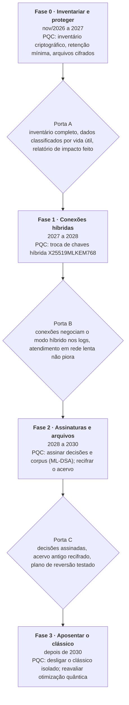

# CitizenTech — Roadmap Quântico: criptografia pós-quântica (PQC)

Global Solution 2026.2 · FIAP · Computação Quântica · Turma 2TIAPF

Avaliação de como a computação quântica ampliaria a solução CitizenTech: gargalo real do protótipo, capacidade quântica escolhida (PQC), roadmap realista e análise de ética, LGPD e ODS. Não há algoritmo quântico a programar; o foco é o raciocínio.

Documento completo (com diagrama editável): Roadmap Quântico CitizenTech, no Claude Docs. Este README é o resumo para o repositório.

## Integrantes

| Nome completo | RM |
|---|---|
| Luís Fernando de Oliveira Salgado | RM561401 |
| Ricardo de Paiva Melo | RM565522 |
| Jonas Alaf | RM566479 |

## Resumo

O gargalo do CitizenTech que mais cresce com o número de cidadãos atendidos é a **proteção de longo prazo dos dados pessoais**. Cada agricultor novo deixa CPF, NIS e documentos digitalizados guardados e em trânsito sob criptografia (RSA e curvas elípticas) que um computador quântico suficientemente grande conseguiria quebrar. A capacidade quântica escolhida é a **criptografia pós-quântica (PQC)**.

A PQC roda em computador comum, sem hardware quântico, e já tem padrões publicados pelo NIST (FIPS 203, 204 e 205, de agosto de 2024).

> Tese: o quântico não melhora a resposta da IA; ele protege, por décadas, a confiança de quem entregou seus dados ao sistema numa hora de seca.

## O que a IA clássica entrega hoje

| Solução (disciplina) | O que entrega | Resultado medido (dados fictícios ou públicos) |
|---|---|---|
| `citizentech-rpa` (AI for RPA) | Lê o pedido, mascara dados pessoais, classifica o serviço, confere documentos por OCR e responde por e-mail | 93,8% de classificação em 60 pedidos de 23 municípios; 35 de 35 conferências corretas; 0 respostas automáticas sobre o serviço errado em 29 |
| `citizentech-genai` (Generative AI) | Assistente RAG sobre as Cartas de Serviço do gov.br, com citação da fonte e abstenção | 95,3% de serviço certo nos 5 trechos recuperados; 22 de 22 corretas entre as respondíveis (teste de 40 perguntas); 0 vazamentos em 12 cenários |
| `citizentech-dashboard` (Front-end) | Painel Mandacaru: estima perda hídrica, cruza com pedidos e recomenda ações que o gestor aprova, ajusta ou recusa | 63% de acerto do modelo no critério de 40% (milho); decisões auditadas em `output/decisoes.jsonl` |

## Passo 1 — O gargalo: sigilo de longo prazo

A IA clássica do protótipo continua dando conta (9 serviços, 23 municípios). O que fica inseguro é a vida útil do sigilo dos dados acumulados. Pontos sensíveis hoje:

- **Pedidos e anexos:** JSON na inbox, comprovante do CAF e de posse da terra lidos por OCR, cópias em `processed/`.
- **Registros guardados:** `controle.xlsx` e e-mails `.eml` em `outbox/`. Os READMEs não descrevem criptografia em repouso.
- **Conexões:** SMTP (STARTTLS opcional), HTTPS à API do Gemini, painel no Streamlit Community Cloud.
- **Integridade:** o corpus coletado do gov.br e o registro de decisões não têm assinatura digital.

O risco é "colher agora, decifrar depois". A regra de Mosca resume a conta:

```
X + Y > Z
```

- **X:** anos em que o dado deve ficar secreto
- **Y:** anos para migrar a criptografia
- **Z:** anos até existir um computador quântico capaz de quebrar a atual (incerto, por isso usamos cenários)

Dado de longa vida (CPF, NIS, situação previdenciária): X = 25 e Y = 5, logo X + Y = 30. Dado de curta vida (rascunho de e-mail, sessão do painel): X = 3 e Y = 5, logo X + Y = 8.

| Z (anos) | Longa vida (30) | Curta vida (8) |
|---|---|---|
| 5 | 30 > 5: exposto | 8 > 5: exposto |
| 10 | 30 > 10: exposto | 8 < 10: seguro |
| 20 | 30 > 20: exposto | 8 < 20: seguro |
| 30 | 30 = 30: sem folga | 8 < 30: seguro |
| 40 | 30 < 40: seguro | 8 < 40: seguro |

O que está sob controle da equipe é reduzir Y (migrar cedo) e medir X (saber quais dados duram décadas).

## Passo 2 — Por que PQC e não outra capacidade

| Capacidade | Onde encaixaria | Por que não é o gargalo hoje | Maturidade |
|---|---|---|---|
| Otimização | Escolher onde fazer vistoria e mutirão do CAF | O painel ordena 23 municípios e sugere 5 ações; heurística resolve em segundos | Experimental; vantagem não demonstrada nesse tamanho |
| Simulação | Clima e balanço hídrico | O erro vem de ignorar solo e fases da cultura, não de falta de cálculo | Útil em química e materiais |
| Busca em grandes bases | Recuperação no RAG | Corpus de 9 serviços; BM25 + vetores acerta o serviço em 95,3%; Grover dá ganho só quadrático | Teórica para esse uso |
| **PQC** | Conexões, arquivos, assinaturas de decisões e do corpus | Cada cadastro novo aumenta o volume de dado com sigilo de décadas | **Padrões NIST de 2024; já nos navegadores** |

Ressalvas: a PQC não usa computador quântico (são algoritmos clássicos resistentes a ele) e tem custo de tamanho: no nível 3, a chave pública do ML-KEM tem 1.184 bytes contra 32 do X25519, e uma assinatura ML-DSA-65 tem cerca de 3,3 KB contra 64 bytes do Ed25519. Em conexão rural fraca, o tamanho do handshake merece teste.

## Passo 3 — Roadmap em quatro fases e três portas



| Camada | Hoje (IA clássica) | O que o quântico agrega | Fase |
|---|---|---|---|
| Pedidos e anexos (RPA) | Máscara de dados, OCR, conferência; arquivos em disco | AES-256 com chave encapsulada por ML-KEM-768 (FIPS 203); o NIST não prevê trocar o AES | 0 e 2 |
| Conexões (robô, RAG, painel) | TLS, SMTP/STARTTLS, API do Gemini | Troca de chaves híbrida X25519MLKEM768 (exige suporte do servidor) | 1 |
| Registro de decisões (painel) | `decisoes.jsonl` com identificação digitada | Assinatura ML-DSA (FIPS 204); SLH-DSA (FIPS 205) como alternativa | 2 |
| Corpus das Cartas de Serviço (RAG) | Coleta do gov.br com URL e data; guardrails | Assinar cada versão coletada para detectar adulteração | 2 |
| Escolha de ações (painel) | Ordenação de 23 municípios, 5 ações | Otimização quântica apenas reavaliada, sem ganho esperado hoje | 3 |

## Benefício esperado

| Quem | O que ganha | Como medir |
|---|---|---|
| Agricultor familiar | Confiança de que CPF, NIS e documentos não serão expostos no futuro | % dos dados de longa vida sob PQC híbrido; zero incidentes com dado capturado e decifrado depois |
| Gestor e coordenação | Decisões assinadas, auditáveis anos depois | % das decisões com assinatura verificável |
| Sindicato, EMATER, prefeitura | Troca de dados por canal que resiste ao futuro | % das conexões com troca de chaves híbrida |
| Equipe técnica | Migração planejada, com plano de reversão | Tempo de handshake em rede lenta; nº de pontos com algoritmo trocável |

As metas numéricas devem ser definidas na fase 0, depois do inventário.

## Passo 4 — Ética, LGPD e ODS ao longo do roadmap

Os artigos da LGPD (Lei 13.709/2018) são referência de estudo, não parecer jurídico; se o sistema for operado por órgão público, valem também os arts. 23 a 30.

| Fase | Ética | LGPD | ODS |
|---|---|---|---|
| 0 | Minimizar: guardar menos é mais seguro que cifrar mais; explicar ao agricultor, em linguagem simples, o que fica guardado e por quanto tempo | Art. 6º; art. 11 (BPC e salário-maternidade podem revelar saúde ou deficiência); art. 37; art. 38; arts. 15 e 16 | 16.6; 1.3 |
| 1 | Equidade: não piorar o acesso de quem tem sinal fraco; manter atendimento humano | Art. 46; art. 48; art. 33 (envio de texto à API do Gemini é transferência internacional) | 10.2; 9.5 |
| 2 | Responsabilização: a assinatura registra quem aprovou, mas não torna mais certo um modelo que acerta 63%; o gestor continua decidindo | Art. 20 (revisão de decisões automatizadas); art. 18 (eliminação também nos backups recifrados); art. 6º, X | 16.6; 13.1; 2.3 |
| 3 | Proporcionalidade: só adotar otimização quântica com ganho demonstrado; evitar "quantum washing" | Art. 38 (atualizar o relatório de impacto); art. 50 | 9.5; 13.1 |

ODS 2 e 1 são o fim (renda e proteção de quem perde a safra); ODS 13, 16 e 9 são o meio (resiliência climática, instituições confiáveis, capacidade tecnológica).

## Realismo: limites e riscos

- **Não há dado real hoje:** os dados do projeto são fictícios; a PQC só é urgente com cadastro real e retenção longa.
- **O prazo da ameaça é incerto:** o Z da regra de Mosca é desconhecido; por isso usamos cenários.
- **Prazos do NIST são referência, não obrigação:** a versão final do NIST IR 8547 (27/10/2026) deprecia RSA e curvas elípticas depois de 2030 e os proíbe depois de 2035 nos padrões do NIST; os prazos federais citados valem para sistemas do governo dos EUA.
- **Transporte depende do provedor:** no Streamlit Community Cloud o grupo não controla o TLS do servidor; o grupo controla arquivos, assinaturas e a escolha do provedor.
- **PQC não corrige o resto:** phishing, senha fraca e erro de implementação continuam sendo os caminhos mais prováveis de vazamento; por isso o modo híbrido mantém a camada clássica.
- **Otimização quântica não está prometida:** com 23 municípios e 5 ações, nenhum ganho é esperado; só se reavalia com centenas de municípios e restrições logísticas reais.
- **Fora do escopo:** distribuição quântica de chaves (QKD), que exige fibra e hardware dedicados.

## Fontes

- READMEs dos repositórios `citizentech-rpa`, `citizentech-genai` e `citizentech-dashboard`.
- [NIST IR 8547 final: o que mudou em relação ao rascunho](https://postquantum.com/security-pqc/nist-ir-8547-final/), análise de Marin Ivezic, outubro de 2026.
- [FIPS 203 (ML-KEM)](https://csrc.nist.gov/pubs/fips/203/final).

**Conferir antes de entregar:** os artigos da LGPD, as metas dos ODS e os tamanhos de chave do ML-KEM-768 e do ML-DSA-65 foram escritos de memória e não foram reabertos nas fontes oficiais.
